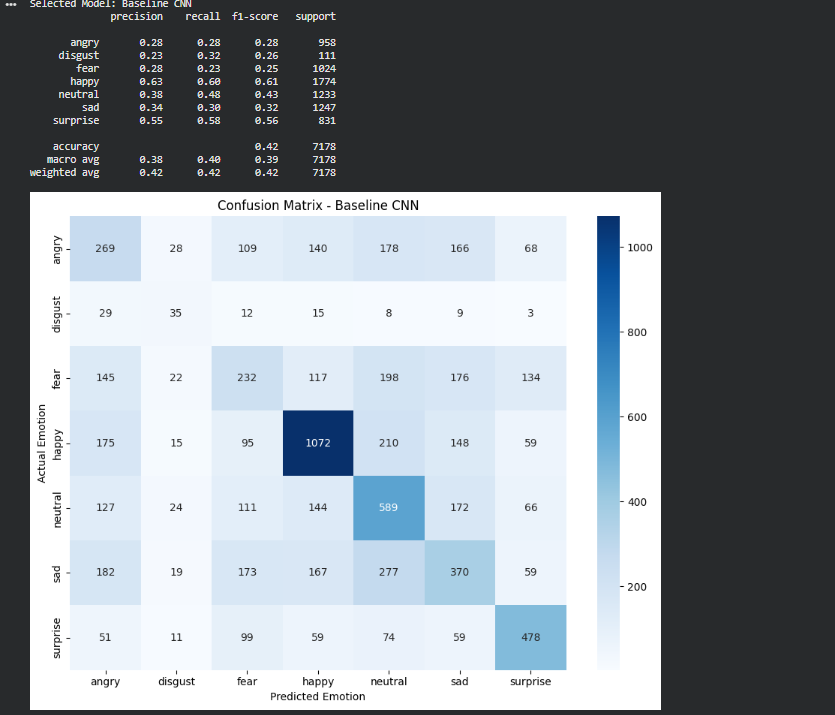
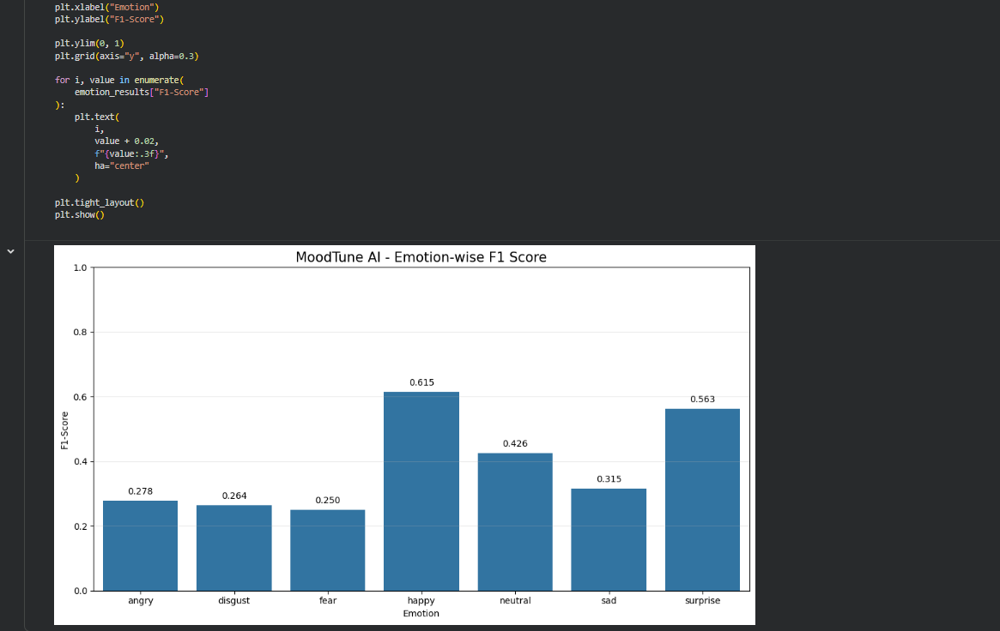
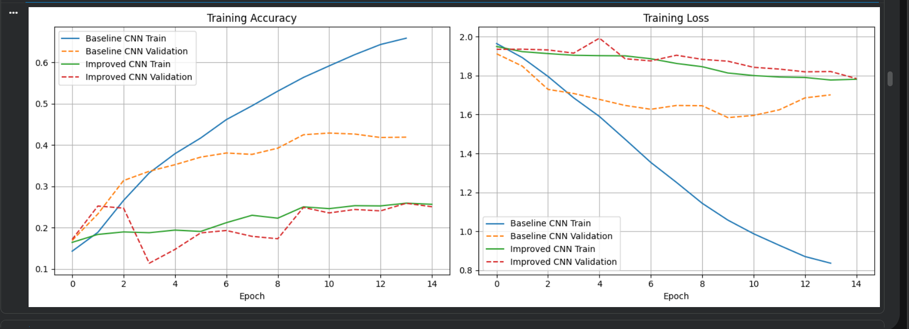
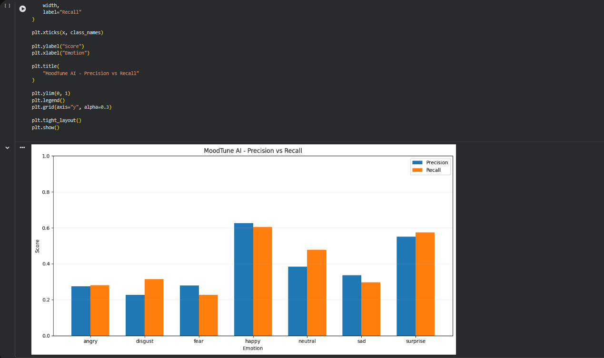
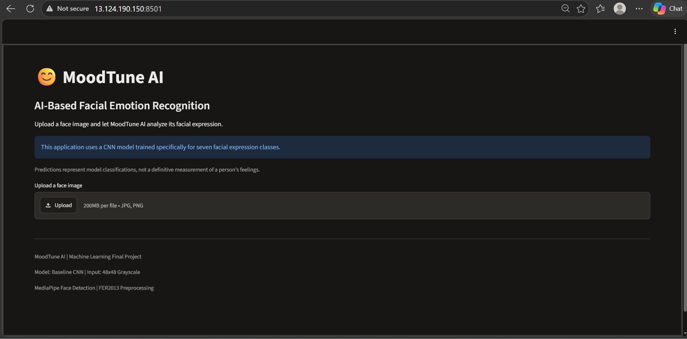
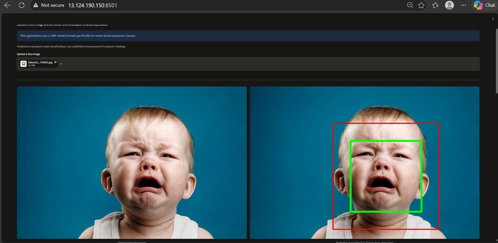
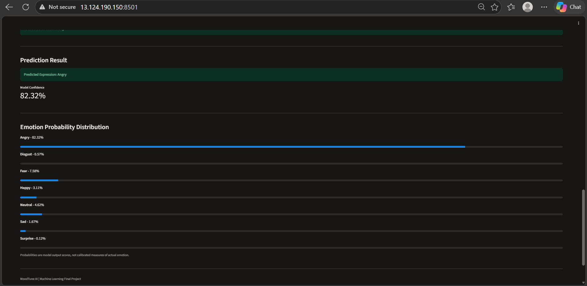

MoodTune AI
AI 기반 얼굴 표정 인식 시스템
MoodTune AI는 얼굴 표정 이미지를 7가지 범주로 분류하는 교육용 인공지능 프로토타입입니다.
이 프로젝트에서는 CNN(합성곱 신경망) 모델을 직접 학습하고, 학습된 모델을 Streamlit 웹 애플리케이션에 배포했습니다.


## 0. 프로젝트 정보
- 프로젝트명: MoodTune AI
- 학번: 202438409
- 이름: 진린툰
- Demo URL: http://13.124.190.150:8501 
- GitHub URL: https://github.com/zlt2003zlt-tech/MoodTune-AI
- 주요 기술: Python, TensorFlow/Keras, CNN, OpenCV, Streamlit, AWS EC2

## 1. 문제 정의
- **Who:** 사진 속 얼굴 표정의 분류 결과를 확인하고 싶은 사용자.
- **What:** 업로드한 얼굴 이미지에서 얼굴 영역을 검출한 뒤 7개 표정 클래스 중 하나를 예측한다.
- **When:** 사용자가 웹 앱에 JPG/JPEG/PNG 얼굴 이미지를 업로드했을 때.
- **Why:** 컴퓨터 비전과 CNN 모델 학습·평가·배포의 전체 과정을 직접 구현하고, 표정 분류 결과를 확인할 수 있는 프로토타입을 제공하기 위해서다.
- **차별점:** 외부 감정 분석 API만 호출하는 방식이 아니라, FER2013 형식의 이미지 폴더로 두 개의 CNN을 직접 학습하고 선택한 모델을 Streamlit 앱에 탑재했다.
- **정량 목표:** Accuracy와 Macro F1을 사용해 모델을 비교한다. 목표치는 학습 전에 별도로 기록된 자료에서 확인되지 않아 임의로 만들지 않았다. 제출본에는 사전에 설정한 목표치가 있었다면 실제 값으로 추가한다.

## 2. 데이터
- 데이터 폴더: `fer2013_data/train`, `fer2013_data/test`
- 학습 폴더 원본 이미지 수: 28,775장
- 모델 학습에 선택한 이미지: 8,000장
- 테스트 이미지: 7,178장
- 클래스: angry, disgust, fear, happy, neutral, sad, surprise
- 학습용 선택 데이터 클래스 분포:
  - angry 1,111 / disgust 121 / fear 1,144 / happy 2,011
  - neutral 1,380 / sad 1,352 / surprise 881
- 데이터 출처: Kaggle에서 다운로드한 FER2013 데이터셋
- 데이터 라이선스: 알 수 없음 (Kaggle 데이터셋 페이지에 명시되어 있지 않음)
- **선정 이유:** 7개 표정 클래스를 포함한 이미지 폴더 구조로 CNN 다중 클래스 분류 실험을 수행할 수 있기 때문이다.

## 3. 데이터 전처리
1. 이미지 파일을 PIL로 읽고 grayscale(`L`)로 변환했다.
2. 이미지를 48×48 픽셀로 리사이즈했다.
3. 픽셀값을 255로 나누어 0~1 범위로 정규화했다.
4. 모델 입력에 맞게 채널 차원을 추가해 `(48, 48, 1)` 형태로 구성했다.
5. 학습 데이터 8,000장을 클래스 비율을 유지하는 층화 추출로 선택했다.
6. 선택 데이터는 `train_test_split(test_size=0.15, random_state=42, stratify=y)`로 학습 6,800장과 검증 1,200장으로 분리했다. 별도 테스트 폴더 7,178장은 학습/검증 분리와 별도로 유지했다.
- Seed: 42
- 선택된 8,000장 기준 분할: Train 85% (6,800), Validation 15% (1,200)
- 별도 Test: 7,178장 (별도 폴더 전체)
- 전처리 전후 비교: 원본 컬러/원본 크기 이미지가 48×48 grayscale, 0~1 정규화 배열로 변환되었다. 보고서에는 노트북의 원본 이미지와 전처리 이미지 캡처를 추가한다.

## 4. 모델
- **Baseline CNN:** Conv2D(32) → MaxPooling → Conv2D(64) → MaxPooling → Flatten → Dense(128) → Softmax(7).
- **Improved CNN:** 데이터 증강(RandomFlip, RandomRotation, RandomZoom, RandomTranslation), Batch Normalization, Dropout을 포함한 CNN.
- 두 모델 모두 직접 학습했다. Optimizer는 Adam이며, 학습 설정은 최대 15 epochs, batch size 64, seed 42, class weights 적용이다. EarlyStopping, ReduceLROnPlateau, ModelCheckpoint 콜백을 사용했다.
- **최종 선택:** Baseline CNN. 검증 Macro F1은 Baseline 0.3684, Improved 0.2032였고, 테스트 Accuracy와 Macro F1도 Baseline이 더 높았다.

## 5. 평가 결과 (Model Evaluation)
### 5.1 Baseline CNN Confusion Matrix

Baseline CNN 모델의 감정별 예측 결과를 혼동 행렬로 확인했습니다.


 

### 5.2 Emotion-wise F1 Score
7가지 감정 범주별 F1 Score를 비교하여 각 감정에 대한 분류 성능을 확인했습니다.


 

### 5.3 Training Accuracy and Loss Comparison
Baseline CNN과 Improved CNN의 Training 및 Validation Accuracy와 Loss를 비교했습니다.

 


### 5.4 Precision vs Recall
Precision과 Recall을 비교하여 모델의 감정 분류 성능을 평가했습니다.



- 최종 모델: Baseline CNN (`emotion_model.keras`)
- 테스트셋에서 Baseline CNN은 7,178장 중 4,133장을 오분류했다(오분류율 약 57.58%).
- 클래스별 F1-score: angry 0.28, disgust 0.26, fear 0.25, happy 0.61, neutral 0.43, sad 0.32, surprise 0.56.
- 자주 혼동한 쌍: sad→neutral 277건, happy→neutral 210건, fear→neutral 198건, sad→angry 182건.
- 분석: happy와 surprise는 상대적으로 분류 성능이 높았지만 disgust, fear, angry, sad는 낮았다. 클래스 불균형과 표정 간 시각적 유사성이 성능에 영향을 주었을 가능성이 있다.


## 6. 서비스 프로토타입
- Streamlit 앱이 `emotion_model.keras`와 `class_names.json`을 로드한다.
- OpenCV Haar Cascade로 얼굴을 검출하고, 검출된 얼굴 중 가장 큰 얼굴을 선택한다.
- 얼굴 영역을 grayscale 48×48로 변환하고 0~1 정규화 후 CNN에 입력한다.
- 사용 방법: 웹 앱 접속 → JPG/JPEG/PNG 얼굴 사진 업로드 → 얼굴 검출 및 예측 결과 확인.
- 얼굴이 검출되지 않으면 안내 메시지를 표시한다.
- ## 7. 애플리케이션 실행 화면

### 1. 메인 화면
MoodTune AI의 메인 화면과 이미지 업로드 기능입니다.



### 2. 이미지 업로드 화면
사용자가 분석할 얼굴 이미지를 업로드한 화면입니다.



### 3. 감정 예측 결과 화면
업로드한 얼굴 이미지에 대한 예측 감정, 모델 신뢰도 및 감정별 확률 분포를 보여줍니다.



## 7. 배포
- 플랫폼: AWS EC2
- 실행 방식: Streamlit 서버를 `0.0.0.0:8501`로 실행
- Demo URL: http://13.124.190.150:8501
- 주의: EC2 중지/재시작 후 공인 IP가 변경될 수 있으므로 제출 직전 현재 URL을 확인하고 업데이트한다.

## 8. 실행 방법
### 실행 환경
- Python 환경에서 실행
- 주요 패키지: Streamlit, TensorFlow, NumPy, Pandas, Pillow, OpenCV

### 설치
```bash
pip install -r requirements.txt
```

### 실행
```bash
streamlit run app.py --server.address 0.0.0.0 --server.port 8501
```

### 모델 파일 위치
- 프로젝트 루트: `emotion_model.keras`
- 클래스 목록: `class_names.json`
- 본 제출 초안 ZIP에는 모델 결과 원본 `MoodTune_AI_Results.zip`이 별도로 포함된다. 배포 프로젝트 루트에 두 파일을 배치해야 앱이 동작한다.

## 9. Lessons Learned
### PMI
**Plus**
1. 이미지 전처리부터 CNN 두 모델의 직접 학습, 테스트 평가, Streamlit 배포까지 전체 머신러닝 파이프라인을 경험했다.
2. Accuracy뿐 아니라 Macro F1과 클래스별 F1을 비교해 불균형 데이터에서 모델을 평가하는 중요성을 확인했다.

**Minus**
1. Baseline CNN의 테스트 Accuracy는 42.42%, Macro F1은 0.3873으로 실제 사용에 충분히 높은 성능이라고 보기 어렵다.
2. disgust 클래스는 학습 선택 데이터가 121장으로 적었고, 클래스별 성능 편차가 컸다. 실제 사진에서는 얼굴 검출 및 얼굴 영역 잘림 문제가 발생할 수 있다.

**Interesting**
1. 데이터 증강과 더 복잡한 구조를 적용한 Improved CNN이 오히려 Baseline보다 낮은 테스트 성능을 보였다.
2. sad→neutral(277건), happy→neutral(210건), fear→neutral(198건) 등 특정 클래스 쌍에서 혼동이 반복되었다.

### 문제 해결 사례
- **문제:** 실제 업로드 사진에서 얼굴이 검출되지 않거나 얼굴 영역이 정확하지 않은 경우가 있었다.
- **원인:** OpenCV Haar Cascade의 검출 결과가 이미지의 정면 여부, 조명, 얼굴 크기와 위치에 영향을 받는다.
- **시도:** 얼굴 검출 결과가 없을 때 안내 메시지를 표시하고, 검출된 얼굴 중 가장 큰 영역을 선택하도록 구현했다.
- **결과:** 얼굴이 검출된 경우에만 모델 입력을 생성하도록 했지만, 다양한 실제 사진에서 검출 안정성과 얼굴 영역 품질을 더 검증해야 한다.

### **데이터 개선 계획**

1. **데이터 추가 확보:** 이미지 수가 부족한 Disgust(혐오) 클래스를 중심으로 다양한 얼굴 표정 데이터를 추가 수집한다.
2. **데이터 불균형 개선:** 클래스별 이미지 수의 차이를 줄이고, 데이터 증강 기법을 활용해 학습 데이터의 다양성을 높인다.
3. **데이터 품질 향상:** 다양한 조명, 얼굴 각도 및 배경을 가진 이미지를 추가하여 실제 환경에서도 안정적으로 감정을 분류할 수 있도록 개선한다.

---
*본 시스템은 표정 이미지의 패턴을 분류하는 학습용 프로토타입이며, 사람의 실제 감정이나 심리 상태를 확정하지 않는다.*
